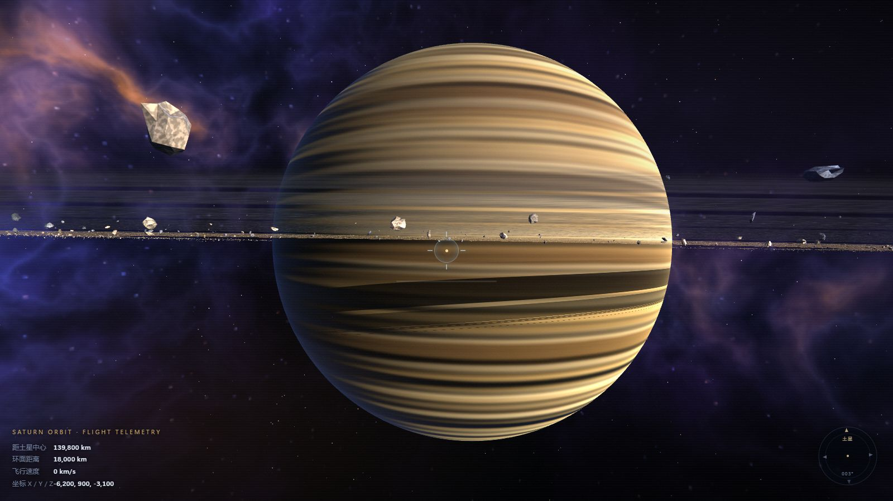
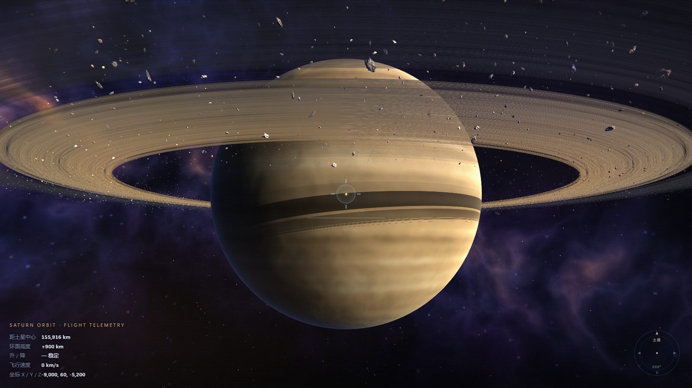
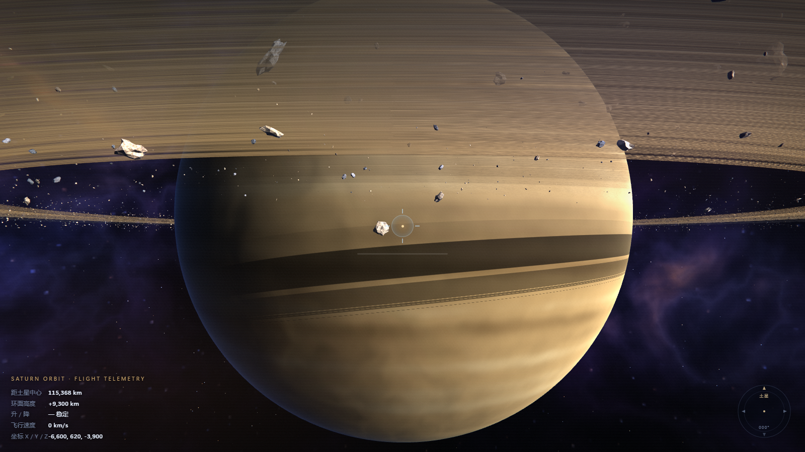
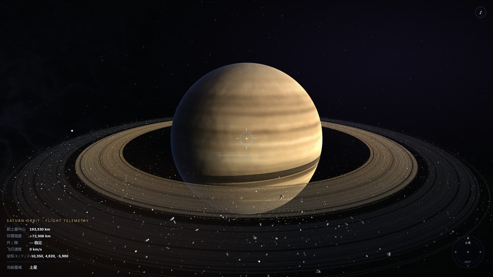
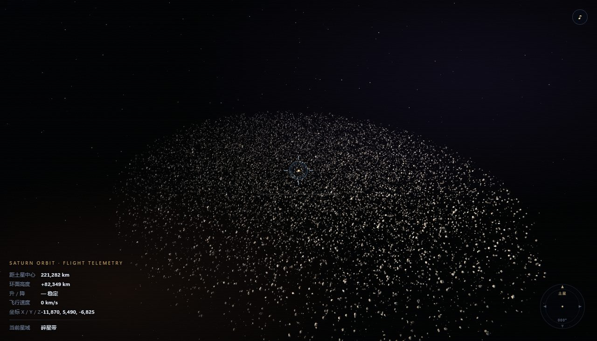
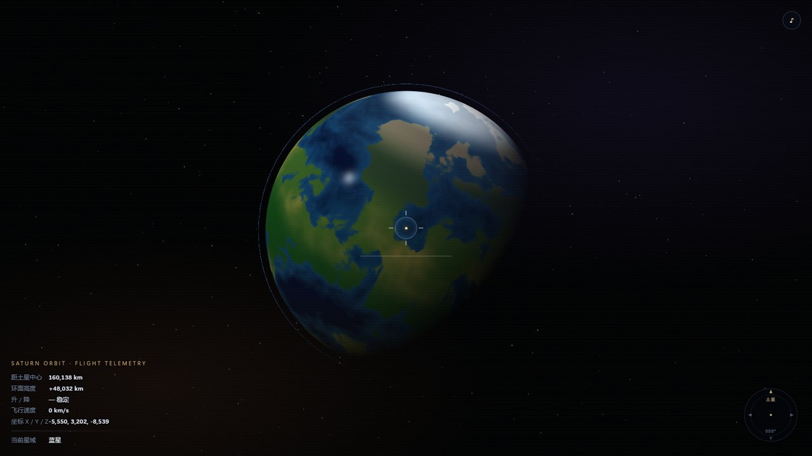
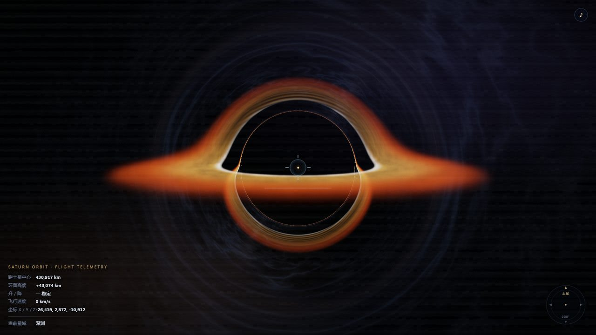

# 环带漫游者 · Ring Wanderer

土星轨道的第一人称深空飞行小游戏。纯 WebGL 程序化生成，**没有任何贴图文件、外部模型或构建步骤**。






## 在线试玩

**https://name2063236.github.io/ring-wanderer/**

打开即玩，无需下载或安装。

> 也可以下载后直接双击 `index.html` 运行（three.js 已内置，无需联网）。

## 操作

| 按键 | 作用 |
| --- | --- |
| `W` `A` `S` `D` | 沿视线方向平移飞行 |
| `Space` | 上升（沿世界 Y 轴，HUD 会显示 ▲ 上升） |
| `Shift` | 下降（沿世界 Y 轴，HUD 会显示 ▼ 下降） |
| 鼠标 | 锁定后可自由环视，俯仰限制 ±88° |
| `F` / `Ctrl` | 星际巡航加速（约 8.5 倍速，伴随 FOV 拉伸与镜头震动） |
| `Q` / `E` | 机体滚转（`Q` 向右倾、`E` 向左倾，**无角度上限**，可连续翻滚） |
| `R` | 复位滚转（保持当前朝向）并清零速度 |
| `P` | 拍照模式（空格拍摄并保存 PNG） |
| `L` | 航行日志 |
| `T` | 跃迁到另一片星空 |
| `Esc` | 释放鼠标 · 打开设置面板 |

> 鼠标灵敏度为基础值 × 0.75（`0.00165 rad/px`），可在设置面板里 0.4× ~ 2.5× 调节。

> 浏览器安全策略要求指针锁定必须由一次真实点击触发，因此开场界面上的「进入轨道」按钮是必需的。

> **触屏设备**：自动切换为触屏模式——拖动屏幕环视，按住左下角前进。

## 玩法

这版加入了真正的游戏循环，不再只是沙盒：

**小行星碰撞** —— 撞上岩石会被判定为撞击：屏幕红边一闪、镜头猛震、速度衰减到 25%，
并伴随一记低频闷响，0.7 秒冷却避免贴着石头时连续触发。

> 碰撞检测不读回 GPU：远处 9400 颗岩石的位置本来就以轨道参数（`aOrbit`/`aAngle0`/`aSpeed`/`aY`）
> 存在 CPU 内存里，用与顶点着色器完全一致的公式复算当前角度即可；
> 先用「轨道半径差」和「垂直距离」两级快速排除，再对幸存者做精确距离比较。

**环境音** —— 全部由 WebAudio 现场合成，零素材：
低频 drone 打底（两个相差 0.7Hz 的振荡器产生极慢拍频）、引擎噪声随速度改变低通截止频率、
加速时叠加带通呼啸、撞击闷响、采样提示音。右上角 ♪ 按钮可随时静音。

> 音频必须在用户手势的同一调用栈内启动，所以初始化放在「进入轨道」按钮的 click 里。

## 环带内部：为什么值得飞进去

环带厚度是 520 世界单位——**它本来就是一个可以进入的体积**，只是之前玩家只从上面飞过。

现在钻进环平面后，会触发一套由「环内深度」驱动的系统：

- **体积雾**：密度同时取决于「距环平面的垂直距离」和「是否落在环的径向范围内」，
  再乘以分区系数（B 环最浓，A 环次之，C 环最稀）。雾在 bloom 之后叠加，
  作为最终一层合成，所以不会被泛光洗掉。
- **冰粒**：2600 颗粒子以相机为中心做环形包裹，只有进入环带才可见，
  提供「穿行于物质中」的实感。
- **能见度急剧下降**：靠近环面时几乎看不清远处，只能凭罗盘和前向速度爬出来。

这是整个游戏里唯一让你感到「危险」的时刻——在此之前，一切都很美，但都很安全。

## 四颗土卫：各自有签名奇观

不写「随便加点特效」，四颗卫星各按真实天文特征实现：

| 卫星 | 奇观 | 真实依据 |
| --- | --- | --- |
| **土卫二** Enceladus | 南极冰喷泉 | 水冰羽流从南极裂隙喷出数百公里，是太阳系最壮观的景象之一 |
| **土卫八** Iapetus | 阴阳脸 | 前导半球反照率约 0.05（近煤渣），后随半球约 0.6，太阳系最极端的反照率对比 |
| **土卫六** Titan | 橙色浓雾大气 | 浓厚雾霾几乎遮蔽表面，米氏散射让明暗交界线非常柔和 |
| **土卫三** Rhea | 撞击坑密布的冰壳 | 作为安静的对比项 |

## 背光时刻：一个已经存在、只差点亮的秘密

星环着色器里本来就有前向散射项 `pow(dot(-L, V), 5.0)`：
当你飞到土星的**背光侧、回头望向环带**时，冰晶会把阳光散射向你，整条环会亮起来。
这正是「暗淡蓝点」那张著名照片里的光轴。

这个效果之前就已经做出来了，只是没人知道它在那儿。
现在当你的位置接近反日方向时，屏幕下缘会出现一条极淡的刻度提示——玩家会好奇，会去追。

## 跃迁：不模拟距离，只模拟过渡

先说个硬约束：当前 1 单位 = 15 km，远平面 400,000 单位。
土卫六轨道 ≈ 81,000 单位（能渲染），但**地球轨道需要 997 万单位，超出远平面 25 倍**。

也就是说：**土星的行星系统就是这个尺度下的天然边界**。想加地球火星，就必须改尺度，
而改尺度会毁掉「土星占满视野」的压迫感。

所以跃迁不做真位移，做**缝合**：每个星球是一个独立场景，用一道缝连起来。
按 `T` 触发，四段过渡：

1. **蓄力** —— 星尘朝视线拉成流线，视野压缩到 0.55×（长焦感）
2. **爆闪** —— 白屏 + 同心放射条纹 + 泛光暴涨
3. **缝合** —— 在白色瞬间**重烤天空**（换种子 = 换一套星云 = 换一个宇宙）
4. **展开** —— 反向播放，新星域淡入

好处是：永远不用模拟那段距离，只模拟「过渡」本身——而过渡恰恰是最容易做出电影感的。

## 拍照与航行日志

**拍照模式**（`P`）—— 冻结时间、隐藏 HUD、自由取景，空格拍摄。
导出时把 canvas 画到 2D canvas 上，再叠一行遥测水印（距土星距离 / 速度 / 时间戳），
直接下载 PNG。

**航行日志**（`L`）—— 不弹成就窗，安静地记录「你做过什么」：
第一次深入土星近旁、第一次飞进环带内部、飞到环面之上、完成跃迁、找到遗物……
可导出为文本。这比任何收集品都更能让人记住这一次，因为它是**你自己的这一次**。

**稀有遗物** —— 环带外侧某个不起眼的方位，扔了一段断裂的桁架和一点残余指示灯。
不做解释、不做任务、不加语音。漫游类游戏里，一个不属于你的物件比十个任务目标更有分量。

## 跃迁：星轨拉线 → 爆闪 → 另一个世界





按 T（或 M）打开**目的地选择菜单**，点选即可跃迁；也可以直接按数字键 1–4 切换。

打开菜单时指针会自动释放，点击空白处或 Esc 关闭。

> 调试时可用 ?debug=1&world=belt 直接跳转（可选 saturn / belt / earth / blackhole）。

三个目的地**在物理机制上就不同**，不是同一颗行星换配色：

| 世界 | 核心机制 | 实现要点 |
| --- | --- | --- |
| **碎星带** | 超大规模小行星团 | 42,000 颗岩石组成的椭球团块，中心留空；**统一灰褐配色**（真实小行星带 C/S 型都是低饱和灰褐，只有明度与色温微差） |
| **蓝星** | 大气与地面不同旋速 | 高精度地表：真实经纬度映射、分形海岸线、按纬度分生物群区（冰盖/苔原/针叶林/温带/沙漠/雨林）、海洋深浅与太阳耀斑、夜面城市灯光；云层按真实大气环流分层（赤道辐合带多、副热带高压带少、中纬风暴带呈螺旋）；云速是地表的 2.3 倍 |
| **深渊** | 引力透镜与吸积盘 | **刻意不用「球 + 环」结构**：视界是始终正对相机的黑色 billboard 圆盘（球体会露出表面感）、光子环是贴边细亮环、吸积盘倾斜 78° 呈悬垂环带、第二层镜像盘模拟引力透镜把背面翻到上方、多普勒增亮 |

### 过渡：为什么是星轨而不是只有爆闪

只有白闪会给人「屏幕闪了一下」的感觉，没有位移感。
星轨拉线是科幻里最经典的超空间视觉语言，因为它真的在表达「你在高速移动」：

- 1,400 条线段，分布在跟随相机的球壳里
- 强度从 0.08 平滑升到 1.0，线长按 I² 增长（后段急剧拉长）
- 同时球壳向内收缩（事物朝你涌来），FOV 从 60° 压到 37°（长焦）
- 白屏最亮那一瞬切换世界，玩家看不到接缝
- 展开阶段星轨收回、FOV 恢复、新世界淡入

时间线约 3.4 秒：蓄力 1.3s → 爆闪 0.4s → 持白 0.2s → 展开 1.5s。

## 一个修掉的穿模：太阳会透过土星

原来太阳精灵用 `depthTest: true` 试图让土星遮挡它，但没用——太阳在
**120,000 单位**外，而近平面是 1、远平面是 400,000，
这个距离上的深度精度已经不够用了，会与土星表面的深度值互相冲突。

现改为**解析射线判定**：从相机沿恒星方向发射射线，解 `|camPos + t·L|² = R²`
看是否与土星球体相交。遮挡时太阳精灵与镜头光晕一起淡出（12/秒的阻尼，避免硬切闪烁）。

这个判定同时用在两处：太阳精灵本体、屏幕空间镜头光晕。

## 星空背景：这版修掉的五个违和感

1. **颜色过于饱和** —— 紫红青三色并置像糖果。真实星云是低饱和的，
   以蓝灰 / 紫灰为底，只有氢发射区才偏暗玫瑰色，且是局部点缀
2. **星云铺满整个天空** —— 真实天球上大部分区域接近纯黑。现在星云只占约 30%，
   并用低频噪声打碎区域边缘，避免「圆形光斑」的机械感
3. **缺少尺度层次** —— 改为远 / 中 / 近三层气体：薄纱、丝缕、纤维，各有不同对比度
4. **银河带太软像一团雾** —— 改为薄而集中的核心带 + 外层弥散，并用暗尘埃带切分
5. **核心过曝成一团白** —— 改为柔和、有颜色的辉光

另外恒星也改了两处：亮度改用 `pow(rng, 8)` 的极端幂律（真实星空亮星极少），
色温按真实比例分配（O/B 4%、A 12%、F 20%、G 28%、K 24%、M 12%），
过暗的星直接跳过，让深空真正黑下去。

## 关于滚转与鼠标视角

姿态用**四元数**表示，所有旋转都施加在机体自身的坐标轴上：

- 鼠标横向 → 绕机体上轴（永远是屏幕水平方向）
- 鼠标纵向 → 绕机体右轴（永远是屏幕垂直方向）
- `Q`/`E` → 绕机体视轴，真正的横滚

因此无论翻转多少圈、是否倒飞，鼠标手感都完全一致，也不存在角度墙。
早期版本用 `YXZ` 欧拉角 + `roll = clamp(±180°)`，滚转时 yaw 仍绕世界轴施加，
于是倒飞后鼠标会「转不动」，到 ±180° 还会卡死——这两个问题都已修复并有回归测试覆盖。

## 场景内容

- **土星本体** —— 自定义着色器：用「纬向坐标 + 域扭曲」生成连续色带场（不是离散条纹），
  极区冷灰、赤道亮环、低对比奶油配色，叠加微弱的纬向剪切与亮涡；
  法线扰动保持极弱（气态行星没有地形，强扰动会在条带边缘画出山脉般的假暗线）；
  含柔和漫反射防过曝、大气边缘光、环在星球上的本影与半影投影。
- **冰质星环（立体实体）** —— 不再是单层平面：
  - 环带有真实几何厚度（约 930 km），上下表面 + 内外侧壁构成封闭实体
  - 侧壁由顶点属性 `aSide` 显式标记（不靠法线判断——表面起伏会把法线弄斜，
    早期版本因此把大片表面误判成侧壁，整条环带发灰发糊）
  - 表面起伏做成沟槽状，暗示环缝；侧壁有层理条纹与散射亮边
  - 启用 `depthWrite` + `alphaTest`，避免上下表面与侧壁互相叠加混色
  - 4096×4 的 1D 环结构贴图离线烘焙（近景可见真实环缝、小环、恩克缝／基勒缝），mipmap 自动消除远处摩尔纹
  - 含 C 环 / B 环 / A 环分区配色、前向散射光环感、行星本影、漂浮冰块颗粒
- **小行星** —— **9400 颗岩石全部收在星环径向范围内（1.14R ~ 2.44R）**，不再向外铺开成平面；
  厚度方向才是重点：主体在环带上下表面之间密集堆积（双峰分布，模拟环带边缘），
  另有约 20% 的"飞散碎石"分布到更外侧，读起来像被撞出环面的颗粒。
  垂直跨度约 520 世界单位（≈7800 km）。
  - **每颗岩石独立公转**：顶点着色器里按 `aAngle0 + uTime × aSpeed` 直接算位置，
    角速度遵循开普勒定律（内圈快、外圈慢），所以整条环带是**差动旋转**而非刚性转动。
    CPU 每帧只推进一个 `uTime`，几万颗也能跑满帧。
  - 46 块近景"主角级"岩石同样沿环道公转 + 自转，用于提供尺度参照。
- **土卫** —— Titan / Rhea / Iapetus / Enceladus 沿倾斜轨道公转。
- **深空** —— GPU 噪声烘焙的等距柱状星云（域扭曲 FBM + 带状聚集）、22000 颗星（亮星用点精灵呈现，保持锐利）、银河带、近场视差星尘、太阳方向镜头光晕。
- **速度感** —— 星尘粒子在高速时朝视线方向拉伸并提亮、偏冷白，低速回落到蓝色；
  叠加加速时的 FOV 拉伸（60° → 74°）与镜头微震。
- **后期** —— 三级高斯泛光、色散、暗角、胶片颗粒、扫描线，以及连续掉帧时自动降低渲染分辨率。

## 设置面板

`Esc`（未锁定时）打开，改动即时生效：

| 项 | 范围 | 说明 |
| --- | --- | --- |
| 鼠标灵敏度 | 0.4× ~ 2.5× | 相对基础值 |
| 画质 | 0.5× ~ 1.6× | 缩放渲染像素比；手动指定后自适应画质暂停介入 |
| 泛光强度 | 0 ~ 2× | |
| 星环厚度 | 0.3× ~ 2.5× | 重建环带几何（成本很低，仅在拖动时发生） |
| 环境音 | 开 / 关 | |
| 防止鼠标尖峰 | 开 / 关 | 关掉可用于对比尖峰防护的效果 |

底部「恢复默认」一键还原。

## 项目结构

```
index.html          界面 / HUD / 设置面板 / 拍照栏 / 日志面板
server.js           本地静态服务器（仅预览用）
vendor/three.min.js three.js r157（UMD，本地内置）
src/planets.js      三个目的地：碎星带 / 蓝星 / 深渊
src/starlines.js    跃迁星轨（线段拉丝）
src/util.js         随机数 / 数学 / 共享 GLSL（环剖面在 CPU 与 GPU 中共用同一份定义）
src/sky.js          星云烘焙 + 恒星层 + 环境反射 + 重烤（跃迁用）
src/moons.js        四颗土卫的签名奇观（喷泉 / 阴阳脸 / 浓雾 / 撞击坑）
src/saturn.js       土星 / 星环 / 小行星
src/ringfog.js      环带内部体积雾 + 冰粒
src/audio.js        程序化环境音（WebAudio，零素材）
src/photo.js        拍照模式 + 航行日志
src/warp.js         场景缝合式跃迁
src/player.js       第一人称飞行控制
src/bloom.js        泛光与合成（含后处理钩子）
src/gameplay.js     小行星碰撞检测
src/main.js         装配、主循环、HUD、设置、自检
```

## 自动化验证

页面支持两个调试参数：

```powershell
# 自检：模拟按键与鼠标，逐项校验控制逻辑（截图里会显示 PASS/FAIL）
http://127.0.0.1:8123/index.html?debug=1&selftest=1

# 帧率 / 三角面 / draw call
http://127.0.0.1:8123/index.html?debug=1&fps=1
```

当前自检 **72 / 72 全部通过**（见 [shots/selftest.jpg](shots/selftest.jpg)）：

```
PASS W 前进 :: 移动 31.32 单位
PASS Space 上升 :: Y 变化 39.89
PASS Shift 下降 :: Y 变化 -26.50
PASS A 左移 :: 移动 36.48
PASS D 右移 :: 移动 12.94
PASS 真实事件 Space 必须上升 :: Y 变化 55.65
PASS 真实事件 Shift 必须下降 :: Y 变化 -33.54
PASS 鼠标横向转向 :: 朝向变化 23.6°
PASS 原地转向不位移 :: 位移 0.000
PASS E 持续滚转可翻整圈 :: 累计 -527°
PASS 倒飞 180° 后鼠标横转仍生效 :: 朝向变化 23.6°
PASS 滚转后横转轴为机体上轴 :: 轴对齐 1.000
PASS 滚转后鼠标俯仰仍生效 :: 朝向变化 23.6°
PASS 任意翻滚角度下鼠标均有响应 :: 最差单次响应 18.9° @ 滚转 -18°
PASS 姿态正交归一 :: 最大误差 1.2e-16
PASS 鼠标尖峰被丢弃 :: 单次极端增量只转了 0.0°
PASS 正常鼠标移动不受影响 :: 50px 转了 4.7°
PASS 连续尖峰不会累积失控 :: 20 次异常增量累计 0.0°
PASS 快速甩动仍正常生效 :: 4×180px 转了 68°
PASS 土星碰撞保护 :: 半径 4193
PASS F 星际巡航加速 :: 105 → 886 单位/秒
PASS R 复位保持朝向 :: 朝向偏差 0.00°
PASS 土星本体
PASS 星环
PASS 小行星带实例 :: 9400 颗
PASS 小行星不超出星环径向范围 :: 半径 1.14R ~ 2.44R（星环 1.10~2.42R）
PASS 小行星带具备垂直厚度 :: 垂直跨度 520 单位（约 7797 km）
PASS 小行星带颗粒总数 :: 9400 颗
PASS 近景小行星在公转 :: 46/46 块发生位移
PASS 小行星带公转时间量在推进 :: uTime=102.0
PASS 近景小行星 :: 46 块
PASS 星空背景
PASS 近景岩石碰撞可命中 :: 球体相交
PASS 远离时不误判碰撞
PASS 存在多个可跃迁星球 :: saturn / belt / earth / blackhole
PASS 其他星球已构建 :: 3 个
PASS 初始只显示土星
PASS 星轨模块可用
PASS 星轨强度可设置
PASS 跃迁后切换到新世界 :: belt
PASS 碎星带规模足够 :: 42000 颗
PASS 可跃迁到地球 :: earth
PASS 地球有独立云层
PASS 云层比地面转得快 :: 地面 0.0400 vs 云层 0.0900 弧度
PASS 可跃迁到黑洞 :: blackhole
PASS 黑洞有吸积盘与视界
PASS 可跃迁回土星 :: saturn
PASS 陷入岩石会触发撞击事件 :: 强度 1.50
PASS 设置面板存在
PASS 音效模块可用
PASS 尖峰防护可开关
PASS 环带厚度可调
PASS 星空可重新烘焙 :: 种子 3.7 → 77777
PASS 环带内部有雾 :: 密度 1.00
PASS 远离环带无雾 :: 密度 0.000
PASS 环带半径之外无雾 :: 密度 0.000
PASS 四颗土卫已创建 :: 4 颗
PASS 卫星各有签名 :: Enceladus / Iapetus / Titan / Rhea
PASS 土卫二冰喷泉存在
PASS 背光检测可运行
PASS 航行日志可写入 :: 1 → 2 条
PASS 日志去重 :: 仍为 2 条
PASS 日志可导出为文本
PASS 拍照模块可用
PASS 可进入拍照模式 :: 已冻结画面
PASS 可退出拍照模式
PASS 跃迁模块可用
PASS 跃迁可启动 :: 阶段 charge
PASS 跃迁可正常结束
PASS 存在多个可跃迁星球 :: saturn / ember / glacier / verdant
PASS 其他星球已构建 :: 3 个
PASS 初始只显示土星
PASS 星轨模块可用
PASS 星轨强度可设置
PASS 跃迁后切换到新星球 :: ember
PASS 新星球有自己的太阳方向
PASS 可跃迁回土星 :: saturn
PASS 土星背后的太阳被遮挡 :: 判定为遮挡
PASS 侧面的太阳不被遮挡
PASS 稀有遗物已布置 :: 环带外侧
PASS 无着色器错误
```

> 其中 `真实事件 Space / Shift` 两项走的是完整 DOM 键盘事件链路（`onKeyDown` / `onKeyUp`），
> 不经过 `testInput` 注入，专门用于防止"方向键反向"之类的回归。

`?debug=1` 还支持 `pos=x,y,z`、`look=x,y,z`、`fov=60` 用于定点取景截图。

## 视角为什么会突然跳？（已修复）

如果玩的时候视角每隔一段时间猛地跳到别处，原因有两处，都已处理：

**1. 指针锁定下的鼠标增量尖峰**

浏览器在特定情况下（切换窗口、系统输入法弹出、高回报率鼠标丢包、触控板手势）
会给出一条 `movementX/Y` 大得离谱的事件，例如一次 `90000px`。原实现直接把它
乘进旋转量，一帧就转出 1485°，表现就是视角瞬移。

现在改为**逐事件两级判定 + 每帧累计上限**：

| 单事件位移 | 处理 |
| --- | --- |
| ≤ 250px | 原样生效（正常操作） |
| 250 ~ 600px | 限幅到 250px |
| > 600px | 判定为异常，整条丢弃 |

再对一帧内累计值设 900px 上限，防止多个事件叠加成瞬移。
玩家真实的大幅甩动（多个正常事件叠加）不受影响——自检里 `4×180px` 仍能正常转 68°。

**2. 自适应画质周期性重建渲染目标**

原实现每 1.2 秒判定一次帧率，一旦低于 40fps 就调用 `resize()` 重建全部 render target。
这本身是一次卡顿，卡顿期间浏览器会**积压鼠标事件**，恢复后一次性灌进来，造成周期性跳变。

现在加了迟滞：低帧率需**连续 3 次**（≈3.6s）才降档，高帧率需**连续 6 次**才升档，
中间区间不做任何调整，不会再反复抖动。

> 想确认过滤是否真的在工作：用 `?debug=1&fps=1` 打开右上角浮层，
> 末尾的「尖峰丢弃 N」就是被拦下的异常事件计数。正常游玩时它应该几乎不增长；
> 如果它频繁增长且视角仍然跳，说明你的环境还有其他触发源，可以把这个数字反馈给我。

`?debug=1` 还支持 `pos=x,y,z`、`look=x,y,z`、`fov=60` 用于定点取景截图。

## 尺度说明

为兼顾视觉美感与真实比例，采用 **1 世界单位 = 15 km** 的线性映射：土星半径 58 232 km ≈ 3882 单位，星环外缘（A 环）≈ 2.35 倍土星半径，环带厚度约 930 km（真实值仅 10~100 m，这里为了看见"立体感"而放大）。行星、星环与小行星带之间的相对比例是真实的；但小行星的实际尺寸被显著放大了（真实环中最大颗粒也只有几十米），否则在这个尺度下完全不可见——这是天文可视化里的常规取舍。

> 想让土星更大 / 更小，只改 `src/util.js` 里的 `KM_PER_UNIT` 即可：数值越小，星球在世界中越大，
> HUD 的 km 读数会自动保持一致（`src/main.js` 里的 `START_DIST` 用于保持开场构图）。

## 性能

三角形数量主要来自实例化小行星（约 9400 × 80 tri）。启动时会预编译所有着色器；运行中若连续低于 40 fps 会自动下调渲染分辨率，高于 58 fps 再逐步恢复。
